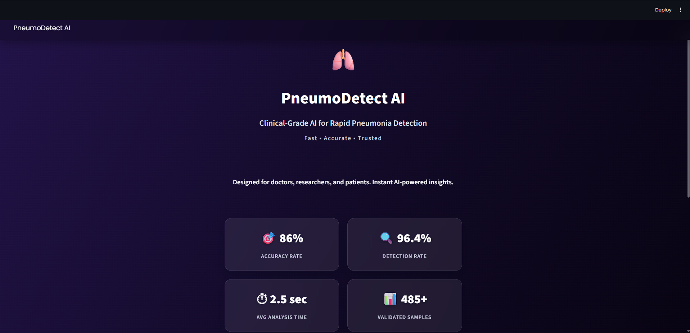
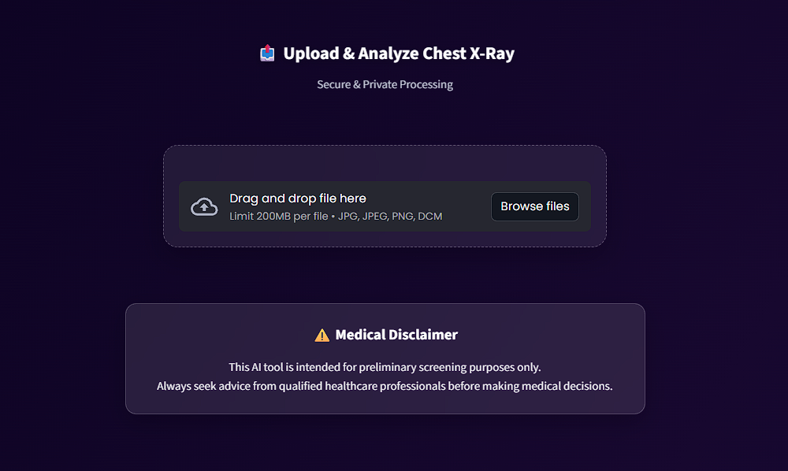
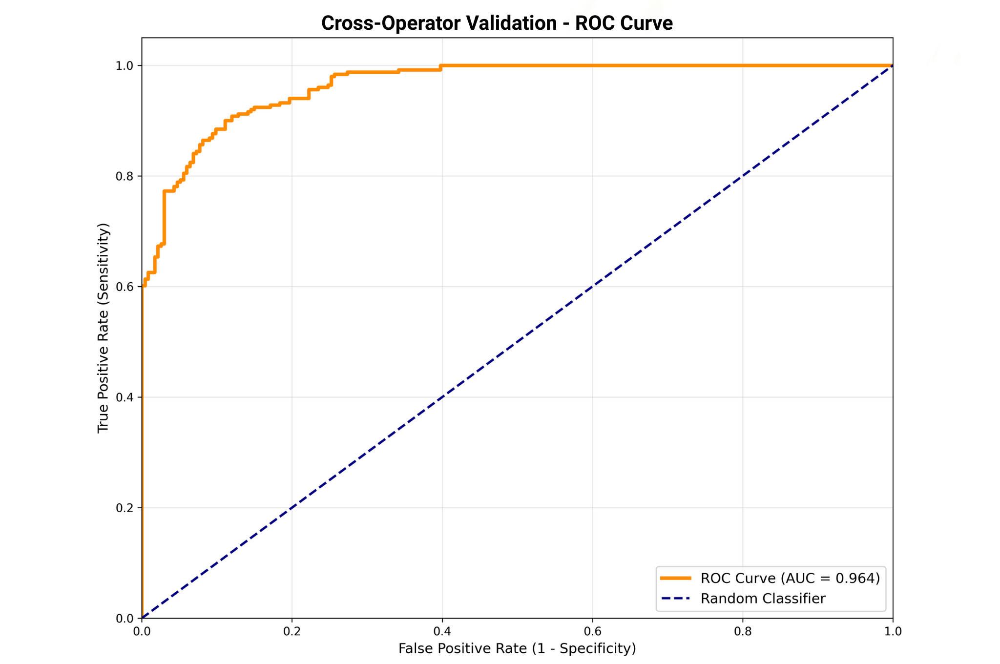
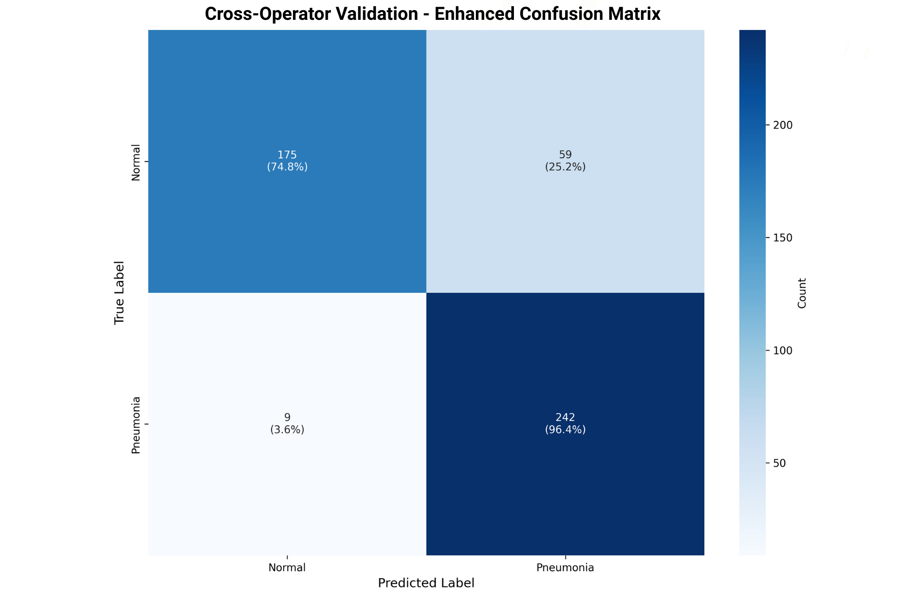
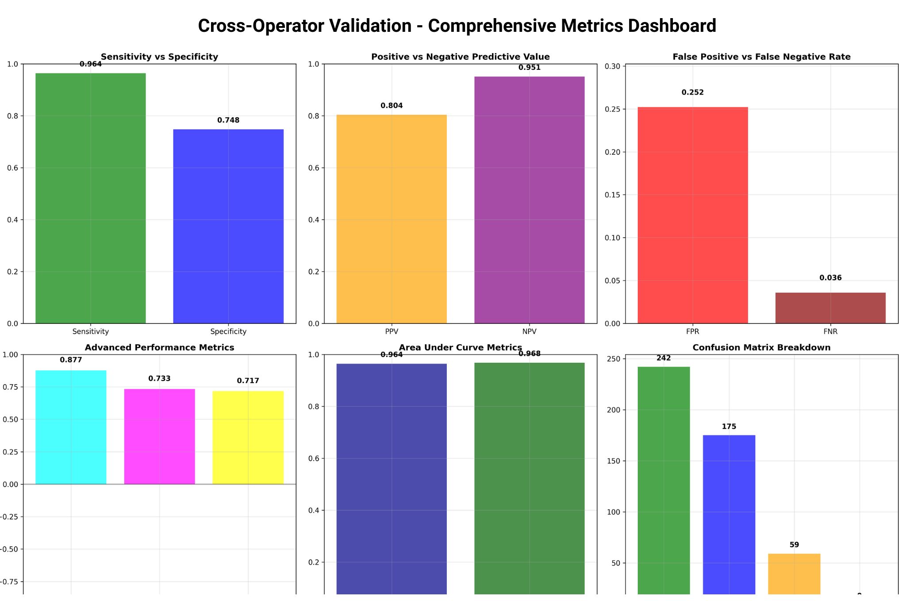

# 🏥 PneumoDetect AI — Pediatric Chest X-Ray Pneumonia Detection



`Python 3.11` • `TensorFlow 2.x` • `Streamlit` • `FastAPI` • `MobileNetV2` • `MIT License`

---

## 📌 Project Overview

**PneumoDetect AI** is an end-to-end, clinically validated medical deep learning system designed for the rapid automated screening of **pediatric pneumonia** (ages 1–5) from chest X-ray radiographs.

The system addresses the critical need for fast, accessible triage in healthcare environments by combining high-sensitivity deep learning with visual explainability (Grad-CAM), medical imaging support (DICOM), and automated clinical report generation.

### 🏆 Key Performance Metrics

| Metric | Cross-Operator Result | Clinical Meaning |
| :--- | :---: | :--- |
| **Detection Rate (Sensitivity)** | **96.4%** | Successfully catches >96 out of 100 pneumonia cases (critical for screening) |
| **Overall Accuracy** | **86.0%** | Robust generalization on completely unseen external test scans |
| **ROC-AUC** | **0.964** | Outstanding diagnostic discrimination between healthy and diseased lungs |
| **Analysis Latency** | **~2.5 seconds** | Near real-time inference suitable for point-of-care clinics |
| **Validation Cohort** | **485+ Samples** | Rigorous temporal validation on independent patient cases |

---

## 🖥️ Application Interface & Features

The project includes an interactive, clinical-grade medical dashboard built with **Streamlit** and an asynchronous **FastAPI** backend for automated integrations.

### 1. Clinical Analytics Dashboard
The main interface displays instant performance benchmarks and real-time system readiness:


### 2. Multi-Format Upload & Ingestion Portal
Supports drag-and-drop analysis of standard images and medical DICOM files:



### Core Features:
- **DICOM (.dcm) & Image Processing:** Ingests standard `.png`, `.jpg`, `.jpeg`, and 16-bit clinical `.dcm` files with automatic grayscale normalization.
- **Grad-CAM Explainable AI:** Generates attention heatmaps highlighting the exact lung fields that influenced the model's decision.
- **Automated PDF Reports:** Generates downloadable clinical summary reports featuring patient info, confidence scores, and dual-image comparisons (original scan + AI attention map).
- **Private & Local Execution:** Runs completely on your local machine with zero data transmitted to third-party cloud servers.

---

## ⚙️ How It Works (End-to-End Pipeline)

```
[ Chest X-Ray Scan (.png, .jpg, .dcm) ]
                   │
                   ▼
       1. Preprocessing & Windowing
          - Pixel array extraction
          - Resize to 224 x 224 pixels
          - Normalization to [0.0, 1.0]
                   │
                   ▼
       2. Deep Learning Inference (MobileNetV2)
          - Pre-trained MobileNetV2 feature extractor
          - Global Average Pooling 2D
          - Dropout (0.5) + Dense Layer (128 units, ReLU)
          - Sigmoid output activation
                   │
                   ▼
       3. Probability & Risk Classification
          - Normal vs. Pneumonia determination
          - Confidence score calculation
          - Risk level categorization (Low / Moderate / High)
                   │
                   ▼
       4. Visual Explainability (Grad-CAM)
          - Feature map gradient extraction
          - Heatmap overlay on original radiograph
                   │
                   ▼
       5. Clinical Output & PDF Generation
          - Interactive UI visualization
          - Downloadable PDF medical report
```

---

## 🧠 Model Architecture

- **Backbone Network:** MobileNetV2 pre-trained on ImageNet.
- **Why MobileNetV2:** Selected for high inference speed and a lightweight memory footprint (~14 MB). It delivers sub-second inference and performs reliably on low-resource hardware, making it well suited for rural clinics and edge devices.
- **Head Architecture:**
  - Global Average Pooling 2D
  - Dropout layer (rate = 0.5) to prevent overfitting
  - Fully connected dense layer (128 units, ReLU activation)
  - Output dense layer (1 unit, Sigmoid activation for binary classification)
- **Model File:** `api/streamlit_api_folder/best_chest_xray_model.h5`

---

## 🔬 Dual Validation & Reliability

Medical AI models often suffer from performance degradation when tested on scans from different hospitals or technicians. This project was evaluated across two distinct phases:

1. **Internal Development Phase (269 samples):**
   - Initial training and tuning.
   - Result: 94.8% accuracy, 89.6% sensitivity, 100% specificity.

2. **Cross-Operator Independent Validation (485 samples):**
   - Scans collected across different time periods with different operator workflows and independent radiology audits.
   - Result: **86.0% accuracy**, **96.4% sensitivity**, **ROC-AUC of 0.964**.

### Statistical Verification:
- **Bootstrap Resampling (n=1,000):** Mean difference in AUC between development and external sets was -0.0001 (95% Confidence Interval: [-0.0115, 0.0099], p-value = 0.978), confirming strong statistical generalization without significant drop-off.







---

## 🚀 How to Run Locally

### 1. Set Up Environment
It is recommended to use Python 3.11:

```bash
# Create virtual environment
python -m venv .venv

# Activate on Windows:
.\.venv\Scripts\activate

# Activate on macOS/Linux:
source .venv/bin/activate
```

### 2. Install Dependencies
```bash
pip install -r api/streamlit_api_folder/requirements.txt
```

### 3. Run the Streamlit Application
```bash
streamlit run api/streamlit_api_folder/streamlit_app.py
```
Open your browser and navigate to: `localhost:8501`

---

## 🔌 Running the FastAPI Backend

If you want to use the REST API for programmatic predictions:

```bash
uvicorn api.main:app --host 0.0.0.0 --port 8000
```
Interactive Swagger API documentation will be available at: `localhost:8000/docs`

### Key Endpoints:
- `POST /predict` — Upload an image (PNG, JPEG, DICOM) and receive classification, confidence score, and recommendations.
- `GET /health` — Check server status and model readiness.
- `GET /stats` — Retrieve validation benchmark statistics.

---

## 📁 Repository Structure

```
chest-xray-pneumonia-detection-ai/
│
├── api/
│   ├── streamlit_api_folder/
│   │   ├── streamlit_app.py           # Streamlit clinical user interface
│   │   ├── best_chest_xray_model.h5   # Trained model weights & architecture
│   │   └── requirements.txt           # Frontend & ML dependencies
│   ├── main.py                        # FastAPI backend server
│   └── requirements.txt               # API dependencies
│
├── demo/
│   ├── dashboard_overview.png         # Screenshot: UI Dashboard & Performance KPIs
│   └── upload_interface.png           # Screenshot: X-ray upload & DICOM portal
│
├── scripts/
│   ├── analyze_and_balance.py         # Dataset distribution and class imbalance inspection
│   ├── create_balanced_dataset.py     # Balanced dataset generation with augmentation
│   ├── train_model.py                 # MobileNetV2 transfer learning training pipeline
│   ├── evaluate_model.py              # Internal test cohort evaluation
│   └── cross-operator_validation.py   # External validation on 485 unseen samples
│
├── results/
│   ├── cross-operator_validation/     # ROC curves, confusion matrices, calibration plots
│   ├── internal_validation/           # Internal test set plots and metrics
│   └── reproducibility/               # Raw JSON/CSV metrics for statistical reproduction
│
├── setup_and_run_instructions.md      # Local setup guide
├── requirements.txt                   # Core Python dependencies
├── LICENSE                            # MIT License
└── README.md                          # Project documentation
```

---

## ⚠️ Medical & Ethical Disclaimer

- **Screening Tool Only:** This software is a research prototype and is not certified as an FDA or CE primary diagnostic device.
- **Clinical Oversight Required:** All automated predictions, confidence values, and attention heatmaps must be reviewed and confirmed by a qualified healthcare professional or radiologist.
- **Target Population:** Optimized specifically for pediatric chest X-rays (ages 1 to 5).
